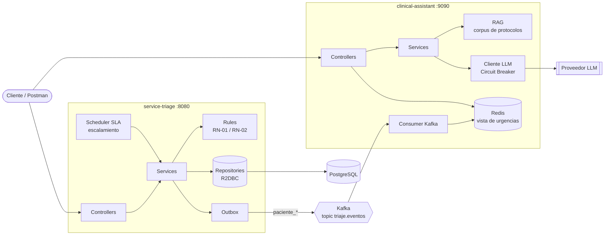

# VidaCruz — Triaje digital con asistente clínico

Sistema backend (APIs + eventos) para las salas de urgencias de VidaCruz. Está compuesto por dos microservicios en Java reactivo (Spring Boot 3 + WebFlux) que se integran de forma asíncrona mediante Kafka.

| Servicio | Puerto | Responsabilidad |
|---|---|---|
| `service-triage` | **8080** | Registro y clasificación automática de pacientes, flujo de estados, monitoreo de SLA y escalamiento, auditoría, reporte de operación y alertas |
| `clinical-assistant` | **9090** | Asistente clínico con IA (RAG sobre protocolos, con citas) y estado de la urgencia en tiempo real |
| `vidacruz-common` | — | Librería compartida (enums y modelos de eventos) |

> Es un sistema solo de backend: no incluye frontend.

---

## Tabla de contenido

1. [Arquitectura](#arquitectura)
2. [Tecnologías](#tecnologías)
3. [Estructura del repositorio](#estructura-del-repositorio)
4. [Ejecución local](#ejecución-local)
5. [Probar las APIs (Postman)](#probar-las-apis-postman)
6. [Endpoints](#endpoints)
7. [Reglas de negocio](#reglas-de-negocio)
8. [Eventos Kafka](#eventos-kafka)
9. [Configuración](#configuración)
10. [Despliegue (Docker)](#despliegue)
11. [Decisiones clave (ADR)](#decisiones-clave-adr)

---

## Arquitectura

Cada microservicio tiene su propia responsabilidad y su propio almacenamiento. **El servicio de triaje nunca depende del asistente**: la única integración es por eventos en Kafka (el triaje publica; el asistente consume).



### Decisiones de diseño destacadas

- **Stack 100 % reactivo**: WebFlux + Project Reactor (`Mono`/`Flux`), R2DBC para PostgreSQL y clientes reactivos para Kafka y Redis; sin llamadas bloqueantes en el event loop.
- **Patrón Outbox** (paquete `outbox` en triaje): el cambio de estado y el evento a publicar se guardan en la misma transacción; un publicador los envía a Kafka. Así no se pierden eventos si Kafka falla justo después del commit.
- **Reglas clínicas aisladas** (paquete `rules`): la clasificación (RN-01) y los SLA (RN-02) viven en clases puras, fáciles de probar con los casos E1–E6.
- **Vista materializada por eventos** en el asistente: el estado de urgencias se reconstruye consumiendo `triaje.eventos` y se persiste en Redis, sin llamar a la API de triaje.
- **Reporte con SQL avanzado**: vista `v_hourly_operation` (agregados por hora) y consulta en el repository con window functions (`SUM() OVER`, `RANK() OVER`) sobre el rango `desde/hasta`. Ver ADR.
- **Librería común** (`vidacruz-common`): enums y modelos de eventos compartidos para mantener el contrato de mensajes en un solo lugar.

---

## Tecnologías

- **Java 25**, **Spring Boot 3**, **Spring WebFlux**, Project Reactor
- **Spring Security** (autenticación en los endpoints)
- **PostgreSQL** + **R2DBC**
- **Apache Kafka** (integración asíncrona entre servicios)
- **Redis** (vista en tiempo real de la urgencia)
- **Resilience4j** (circuit breaker sobre el LLM)
- **Spring AI / LangChain4j** para RAG *(indicar el que se usó)*
- **Micrometer** (métricas) + probes de health/readiness (Actuator)
- **Gradle**, **Docker / Docker Compose**, **Kubernetes** (Azure)
- Tests: JUnit 5, Reactor Test (`StepVerifier`), Mockito, Testcontainers *(si aplica)*

---

## Estructura del repositorio

```
vidacruz/
├── docker-compose.yml
├── vidacruz-common/            # Librería compartida
│   └── src/main/java/com/mvargas/
│       ├── enums/              # Niveles de triaje, estados, tipos de evento
│       └── models/             # Modelos / eventos compartidos
├── service-triage/             # Servicio de Triage (8080)
│   └── src/main/java/com/mvargas/service_triage/
│       ├── controllers/        # Endpoints REST
│       ├── exceptions/         # Excepciones y manejo global de errores
│       ├── mappers/            # DTO <-> entidad
│       ├── outbox/             # Patrón Outbox -> Kafka
│       ├── repositories/       # R2DBC (incluye reporte con SQL avanzado)
│       ├── rules/              # Reglas de negocio (RN-01, RN-02, RN-03)
│       ├── services/           # Casos de uso
│       └── validations/        # Validación de rangos de datos
├── clinical-assistant/         # Servicio Asistente Clínico (9090)
│   └── src/main/java/com/mvargas/clinical_assistant/
│       ├── clients/            # Cliente del proveedor LLM
│       ├── components/         # Consumidor Kafka, RAG, etc.
│       ├── configurations/     # Configuración (Redis, Kafka, Resilience4j...)
│       ├── controllers/
│       ├── exceptions/
│       ├── mappers/
│       ├── repositories/       # Vista en Redis
│       └── services/
└── postman/                    # Colección de Postman
```

---

## Ejecución local

### Requisitos

- Docker y Docker Compose
- Una API key del proveedor de LLM (se entrega por variable de entorno; **nunca** se commitea)

### Un solo comando

Desde la raíz del proyecto:

```bash
docker compose up -d --build
```

Esto levanta: PostgreSQL, Kafka, Redis, `service-triage` y `clinical-assistant`.

Verificar que todo está arriba:

```bash
docker compose ps
```

| Servicio | URL |
|---|---|
| Triage | http://localhost:8080 |
| Asistente clínico | http://localhost:9090 |

Para detener y limpiar:

```bash
docker compose down        # detiene
docker compose down -v     # detiene y borra volúmenes (datos)
```

> **API key del LLM:** define la variable de entorno requerida por el asistente antes de levantar (por ejemplo en un archivo `.env` junto al `docker-compose.yml`, ignorado por git). *Ajusta el nombre de la variable al que usa tu proyecto.*

---

## Probar las APIs (Postman)

En el repositorio se incluye la **colección de Postman** (carpeta `postman/`) con las peticiones de ambos servicios:

1. Importa la colección en Postman.
2. Servicio de triaje → `http://localhost:8080`; asistente clínico → `http://localhost:9090`.
3. Configura la autenticación definida (ver [Seguridad](#resiliencia-observabilidad-y-seguridad)) y ejecuta las peticiones.

---

## Endpoints

### Servicio de Triage — `:8080`

| Método | Ruta | Descripción |
|---|---|---|
| `POST` | `/triage/pacientes` | Registra y clasifica al paciente (RF-01). Devuelve `id`, nivel, `slaMinutos`, estado `REGISTRADO`, `fechaRegistro` |
| `PATCH` | `/triage/pacientes/{id}/estado` | Cambia el estado: `REGISTRADO → EN_CONSULTA / ALTA`, `EN_CONSULTA → ALTA` (RF-02). Inválida → `409` |
| `GET` | `/triage/pacientes/{id}` | Datos del paciente, estado, flags (escalado) y tiempo en el estado actual |
| `GET` | `/triage/reportes/operacion?desde=...&hasta=...` | Reporte por hora: total, conteo por nivel, tiempo promedio de espera y p95 (RF-05) |

### Asistente Clínico — `:9090`

| Método | Ruta | Descripción |
|---|---|---|
| `POST` | `/asistente/consulta` | Consulta en lenguaje natural con RAG. Cuerpo: `{ "pregunta": "..." }` |
| `GET` | `/asistente/estado-urgencias` | Pacientes activos (no `ALTA`) por nivel de triaje, desde la vista en Redis |

### Ejemplo — registrar paciente

```bash
curl -X POST http://localhost:8080/triage/pacientes \
  -H "Content-Type: application/json" \
  -d '{
    "nombreCompleto": "Juan Pérez",
    "edad": 54,
    "frecuenciaCardiaca": 130,
    "presionSistolica": 180,
    "presionDiastolica": 110,
    "spo2": 97,
    "temperatura": 36.8,
    "dolor": 8,
    "gcs": 15,
    "quejaPrincipal": "Dolor torácico"
  }'
```
---

## Reglas de negocio

### RN-01 — Clasificación (primer nivel que se cumple, de mayor a menor gravedad)

| Nivel | Nombre | Condiciones (cualquiera) |
|---|---|---|
| 1 | CRITICO | FC < 40 o FC > 120, SpO2 < 90, P. sistólica < 90, GCS ≤ 8 |
| 2 | URGENTE | SpO2 90–93, P. sistólica 90–100, Temp ≥ 38.5, GCS 9–13 |
| 3 | URGENTE_2 | FC 90–120, Temp 38.0–<38.5, Dolor ≥ 7 |
| 4 | NO_URGENTE | No cumple niveles 1–3 |
| 5 | NO_URGENTE_2 | Nivel 4 y queja administrativa (documentos, recolección de resultados, renovación de recetario, vacunación, seguimiento) |

### RN-02 — SLA por nivel

| Nivel | SLA (min) |
|---|---|
| CRITICO | 5 |
| URGENTE | 10 |
| URGENTE_2 | 30 |
| NO_URGENTE | 60 |
| NO_URGENTE_2 | 120 |

### RN-03 — Idempotencia del escalamiento
Un paciente se escala **una sola vez**. Un paciente en `EN_CONSULTA` o `ALTA` nunca se escala.

### RN-04 — Auditoría clínica
Todo cambio de estado o flag (registro, consulta, escalamiento, alta) queda registrado con timestamp, id de paciente, estado anterior, estado nuevo y tipo de evento. No existe endpoint de eliminación.

### RN-05 — Anti-alucinación
Toda respuesta clínica incluye al menos una fuente válida del corpus. Sin coincidencia relevante, la respuesta es exclusivamente el aviso de que no existe protocolo disponible.

### Validaciones de entrada (RF-01)

| Campo | Rango |
|---|---|
| Frecuencia cardíaca | 20 – 250 bpm |
| Presión sistólica | 60 – 260 mmHg |
| Presión diastólica | 30 – 160 mmHg (menor que la sistólica) |
| SpO2 | 70 – 100 % |
| Temperatura | 34.0 – 42.0 °C |
| Dolor | 0 – 10 |
| GCS | 3 – 15 |
| Edad | 0 – 120 |
| Nombre | 3 – 100 caracteres |

Valor fuera de rango → `400` indicando el campo inválido.

---

## Eventos Kafka

Topic: **`triaje.eventos`** (formato JSON).

| Evento | Se publica cuando |
|---|---|
| `paciente_registrado` | Se registra un paciente |
| `paciente_en_consulta` | Transición a `EN_CONSULTA` |
| `paciente_alta` | Transición a `ALTA` |
| `paciente_escalado` | El paciente supera su SLA sin entrar a consulta |

Los eventos del triaje se publican mediante el patrón **Outbox**. El asistente los consume para mantener en Redis la cantidad de pacientes activos por nivel.

---

## Resiliencia, observabilidad y seguridad

**Resiliencia**
- Circuit breaker (Resilience4j) sobre las llamadas al LLM con fallback explícito (`503`).
- Triaje desacoplado del asistente: si el asistente cae, el triaje sigue operando.
- Outbox para no perder eventos ante fallos de Kafka.

**Observabilidad**
- Probes de health/readiness vía Actuator.
- Logs estructurados con correlación.
- Métricas Micrometer: clasificaciones por nivel, escalamientos y latencia del LLM.

---

## Configuración

Las propiedades del triaje se definen en `service-triage/src/main/resources/application.yaml` y se pueden sobreescribir por variables de entorno. Para probar el escalamiento sin esperar decenas de minutos, ajusta:

- Intervalo de evaluación del scheduler de SLA
- SLA por nivel (minutos)

> *Reemplaza aquí los nombres reales de las propiedades de tu `application.yaml`.*

---

## Tests

```bash
# Desde cada módulo
./gradlew test
```

Cobertura mínima de negocio:

- Clasificación de los pacientes E1–E6
- Transiciones de estado válidas e inválidas
- Idempotencia del escalamiento
- Citas del RAG
- Caso "sin coincidencia" sin alucinación

El LLM se mockea en los tests.

---

## Despliegue

- **Docker**: cada servicio tiene su `Dockerfile`; `docker compose up -d --build` los construye y levanta.

---

## Decisiones clave (ADR)

| ADR | Decisión | Resumen |
|---|---|---|
| ADR-001 | Reporte con vista + window functions | Vista `v_hourly_operation` para agregados por hora; `SUM OVER` y `RANK OVER` en el repository. `consultation_date` la guarda un trigger de BD |
| ADR-002 | Patrón Outbox | Garantiza consistencia entre el cambio de estado y la publicación del evento |
| ADR-003 | Vista de urgencias en Redis | El asistente reconstruye el estado consumiendo `triaje.eventos`, sin llamar al triaje |
| ADR-004 | Modo degradado del LLM | Circuit breaker + fallback `503` |
| ADR-005 | Alertas de escalamiento (RF-06) | _Documentar canal elegido, formato, justificación y supuestos_ |

> Detalle completo de cada ADR en `docs/adr/` *(ajustar a la ruta real)*.

---

## Autor

Desarrollado por **Milciades Vargas liz** como solución a la Prueba Técnica Dev. WebFlux (Senior / Arquitecto).
